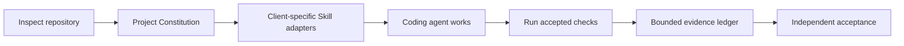

<p align="center">
  
</p>

<p align="center">
  <strong>Evidence-first engineering governance for coding agents.</strong><br>
  Inspect first. Preserve existing guidance. Validate with evidence. Accept independently.
</p>

<p align="center">
  <a href="README.zh-CN.md">简体中文</a> · <a href="README.md">Language index</a>
</p>

> **Release** — `0.1.0-beta.1` is MAHO's first public Beta. GitHub Releases is the authority for signed artifacts; treat PyPI as available only when its project page lists this version. See [What is complete—and what is not](#what-is-completeand-what-is-not).

MAHO is a dependency-free governance layer that gives coding agents a shared engineering contract, safe repository setup, executable validation, bounded evidence, and independent acceptance semantics.

It is not an agent runtime, model router, security sandbox, or promise that every client behaves identically.

## What MAHO does

| Shared engineering contract | Safe multi-agent setup | Verifiable outcomes |
|---|---|---|
| Generates a Project Constitution and machine-readable check contract from repository facts. | Installs only missing guidance and Agent Skills into client-compatible paths without overwriting existing files. | Runs accepted direct commands, records bounded evidence, preserves failures, and separates implementation from final acceptance. |

In practice, MAHO helps a coding agent:

1. **Inspect before editing** — discover stacks, existing instructions, validation signals, and readiness gaps.
2. **Work from one contract** — keep humans and different coding agents aligned on goals, constraints, protected paths, and success criteria.
3. **Bootstrap safely** — preview every change, preserve existing files, and require an explicit apply step.
4. **Validate without shell strings** — execute accepted argument arrays, enforce timeouts, and detect changes to protected paths.
5. **Retain honest evidence** — distinguish facts, inferences, vendor claims, `PASS`, `FAIL`, and `INCONCLUSIVE`.
6. **Accept independently** — keep the implementer separate from the final completion decision.

## Quick start

### 1. Install

MAHO requires Python 3.10 or later and has no runtime Python dependencies. When the [PyPI project page](https://pypi.org/project/maho-harness/) lists `0.1.0b1`, install with:

```bash
pipx install maho-harness
# or
uv tool install maho-harness
maho --version
```

Until then, download the signed wheel and `SHA256SUMS` from [GitHub Releases](https://github.com/Do-fei/maho-harness/releases), verify it, and install the local wheel:

```bash
pipx install ./maho_harness-0.1.0b1-py3-none-any.whl
# or
uv tool install ./maho_harness-0.1.0b1-py3-none-any.whl
```

### 2. Preview—no repository changes

```bash
maho --locale en init /path/to/project --agent codex
```

Review the target, selected client, files that would be created, preserved paths, and `Overwritten 0`.

### 3. Apply the reviewed plan

```bash
maho --locale en init /path/to/project --agent codex --apply --yes
```

Initialization creates only missing paths. Existing project guidance and Skill directories are preserved rather than merged or overwritten.

### 4. Inspect and validate

```bash
maho discover /path/to/project
maho readiness /path/to/project
maho validate /path/to/project
maho context-audit /path/to/project
```

`discover` proposes checks; it does not silently accept them. Review `.harness/project.json`, move approved entries from `proposed_checks` into `checks`, and complete the generated Project Constitution before treating validation as authoritative.

### 5. Add more coding agents

```bash
maho --locale en init . --agent claude-code --agent cursor --apply --yes
maho --locale en init . --agent all --apply --yes
```

`--agent all` installs adapters for all seven verified clients only. Experimental adapters must be selected by name and produce an explicit warning.

For automation, request JSON explicitly:

```bash
maho --json --locale en init /path/to/project --agent codex
```

## How it works



The universal core remains stack-neutral. Optional Stack Packs add conventions for Python, FastAPI, Node.js, React, Next.js, and Electron without changing the completion semantics.

## What is complete—and what is not

| State | Scope |
|---|---|
| **Complete for the public Beta** | Core CLI; zero-overwrite `init`; discovery, readiness, validation, and context audit; bilingual CLI/docs; seven-client adapter selection; allowlisted public export; wheel, sdist, and pipx installation checks. |
| **Verified clients** | Codex, Cursor, Factory/Droid, Claude Code, Kilo Code, Kimi Code, and OpenCode have bounded real-client evidence plus separate independent acceptance. |
| **Experimental adapters** | Gemini CLI, Roo Code, and GitHub Copilot have tested filesystem adapters, but no real-client or independent acceptance in `0.1.0-beta.1`. |
| **Release boundary** | Signed and checksummed GitHub Release artifacts are canonical. PyPI availability, private vulnerability reporting, and anonymous visibility are verified live rather than inferred from a checkout. |
| **Known limitation** | Wheel/sdist builds are installable but not proven byte-for-byte reproducible across different build environments. |
| **Explicitly not claimed** | An agent runtime, model routing, a security sandbox, or identical semantics in every third-party client. |

The repository-side release candidate passed a bounded independent acceptance with the full test suite, a clean public export, and fresh package-install checks. That acceptance did not replay every private client transcript and did not authorize publication. The public [compatibility matrix](docs/en/COMPATIBILITY.md) preserves the supported scope and evidence boundaries.

## Client support

| Release tier | Clients | Meaning |
|---|---|---|
| **Verified** | Codex, Cursor, Factory/Droid, Claude Code, Kilo Code, Kimi Code, OpenCode | Documentation path, filesystem adapter, bounded real-client test, and separate acceptance exist for this Beta. |
| **Experimental** | Gemini CLI, Roo Code, GitHub Copilot | Adapter behavior is tested; real-client behavior and acceptance remain outside the support contract. |

The detailed [compatibility matrix](docs/en/COMPATIBILITY.md) records client versions, Skill roots, evidence boundaries, and acceptance phases separately.

## Core commands

| Command | Purpose |
|---|---|
| `maho init` | Preview or install MAHO guidance and Skills without overwriting existing paths. |
| `maho discover` | Inspect repository stacks and propose validation checks. |
| `maho readiness` | Audit whether the repository is ready for reliable agent work. |
| `maho validate` | Run accepted checks and record bounded evidence. |
| `maho context-audit` | Check always-on guidance against context-budget limits. |
| `maho bootstrap` | Backward-compatible machine-oriented bootstrap command. |

## Documentation

- [Quick start](docs/en/QUICKSTART.md)
- [Architecture](docs/en/ARCHITECTURE.md)
- [CLI behavior](docs/en/CLI.md)
- [Compatibility matrix](docs/en/COMPATIBILITY.md)
- [Project contract schema](schemas/project.schema.json)
- [Public release process](docs/en/RELEASING.md)
- [Uninstall](docs/en/UNINSTALL.md)
- [Security policy](SECURITY.md)
- [Contributing](CONTRIBUTING.md)

## License and project marks

Code and documentation are licensed under the [Apache License 2.0](LICENSE). The MAHO name and sailboat project mark are governed separately by [TRADEMARKS.md](TRADEMARKS.md).

Copyright is attributed to MAHO contributors. **Future Apparatus Laboratory** stewards the project identity and marks. The public source is [`Do-fei/maho-harness`](https://github.com/Do-fei/maho-harness).
